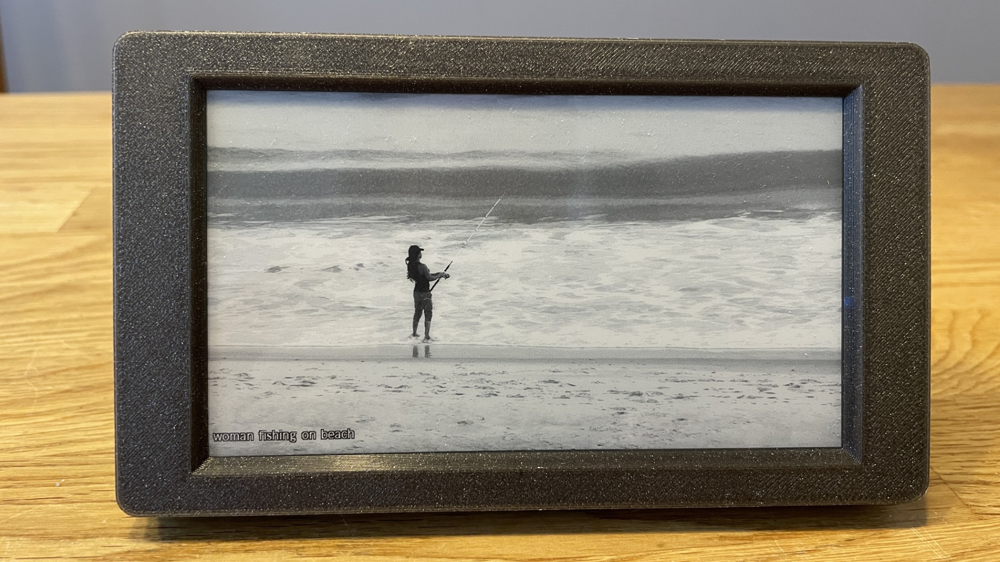

# Inkplate PictureFrame

This is a picture frame application for the [Inkplate 5 V2](https://www.inkplate.io/inkplate-5-v2/) and [Inkplate 10](https://soldered.com/product/inkplate-10-9-7-e-paper-board-copy/) e-paper displays by Soldered Electronics.

The code is based on an example from the [Inkplate-Arduino-library](https://github.com/SolderedElectronics/Inkplate-Arduino-library) and uses [Unsplash](https://unsplash.com/) to download images to display. The original example is converted into [PlatformIO](https://platformio.org/) to make it easier to build and upload the code to the Inkplate device. The code is also extended with features like outlined text for better readability and WifiManager support for easy WiFi configuration.

## Features
* A random image is downloaded from Unsplash using keyword search.

* The images are refreshed at regular intervals and the board goes to deep sleep between images in order to save battery.

* Uses [WifiManager](https://github.com/tzapu/WiFiManager) to manage WiFi connections so that no network credentials are required in the code. If no known network is found, the Inkplate creates an access point where you can connect and configure the WiFi credentials.
    * The Unsplash API key is also configured using WifiManager's configuration portal.
    * You can get your own free API key from [Unsplash Developers](https://unsplash.com/developers) and replace it in the code for your own usage. 

* The description of the current image is shown at the bottom of the display in outlined text for better readability.

* The font used is [Acari Sans](https://github.com/StefanPeev/acari-sans) by Stefan Peev.

## Tips
* If the images on Inkplate 10 appear to have incorrect colors, try to change to another display waveform using the Inkplate library example [Inkplate10_Wavefrom_EEPROM_Programming
](https://github.com/SolderedElectronics/Inkplate-Arduino-library/tree/master/examples/Inkplate10/Diagnostics/Inkplate10_Wavefrom_EEPROM_Programming).
